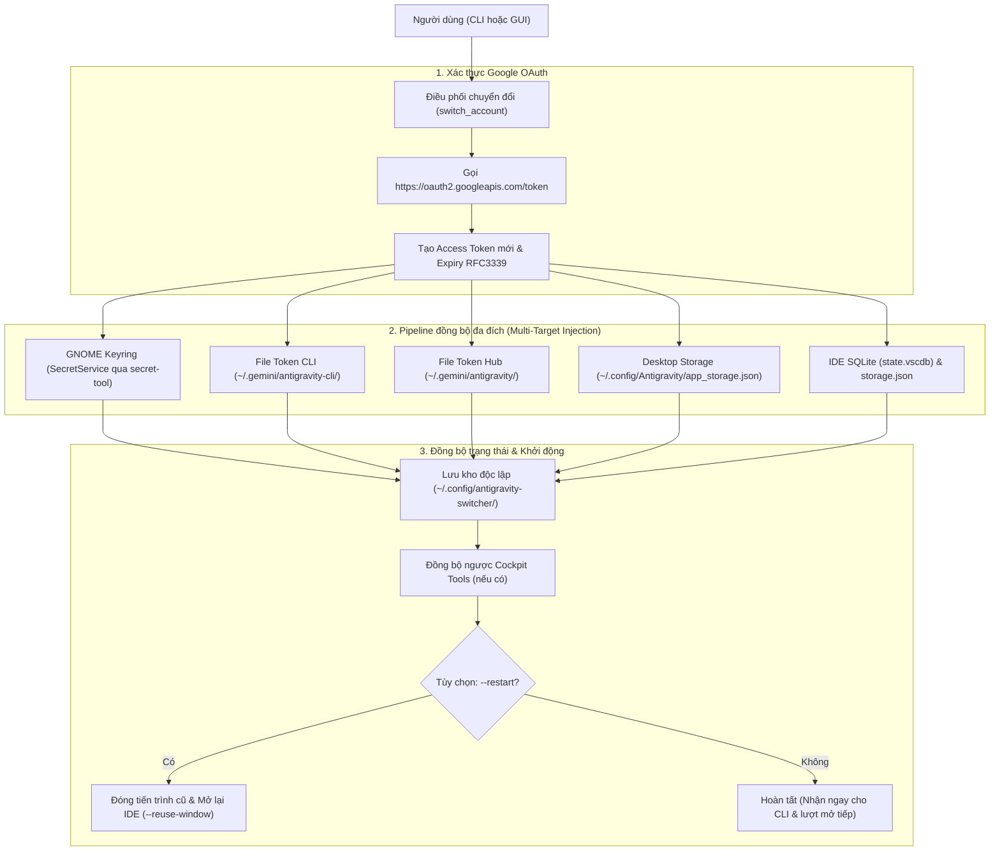

# Kiến Trúc Hệ Thống (Architecture Design)

Tài liệu này đặc tả chi tiết kiến trúc kỹ thuật của **Antigravity Account Switcher**, cơ chế xác thực phân tán trên hệ sinh thái Antigravity và luồng đồng bộ đa đích (Multi-Target Injection Pipeline).

---

## 1. Tổng Quan Kiến Trúc

Antigravity phân tán trạng thái đăng nhập và OAuth token trên nhiều tầng lưu trữ khác nhau tùy theo thành phần (IDE, CLI hoặc Desktop Hub). Để việc chuyển đổi tài khoản diễn ra tức thời mà không cần đăng nhập lại từ trình duyệt, Switcher thực hiện cơ chế đồng bộ đồng thời 5 đích lưu trữ.

---

## 2. Chi Tiết Các Tầng Lưu Trữ (Storage Targets)

### 2.1. GNOME Keyring (SecretService)
- **Dịch vụ (`service`):** `gemini`
- **Người dùng (`username`):** `antigravity`
- **Cơ chế truy xuất:** Gọi tiện ích `secret-tool store` và `secret-tool lookup` qua DBus.
- **Dữ liệu lưu trữ:** JSON envelope chứa `token` (access_token, token_type, refresh_token, expiry, expires_in), `auth_method` ("consumer"), `id_token_email` và `writer_id`.
- **Vai trò:** Đây là nguồn kiểm tra đầu tiên (SSOT) của `agy` CLI và `Antigravity IDE 2.6.0+`.

### 2.2. File Token CLI & Hub Fallback
- `~/.gemini/antigravity-cli/antigravity-oauth-token`
- `~/.gemini/antigravity/antigravity-oauth-token`
- **Phân quyền:** Bắt buộc `0o600` (chỉ user đọc/ghi).
- **Vai trò:** Cung cấp token dự phòng cho các tiến trình nền của Antigravity CLI khi không thể kết nối tới DBus Keyring (ví dụ: phiên SSH hoặc headless).

### 2.3. Antigravity Desktop Hub Storage
- `~/.config/Antigravity/app_storage.json`
- Cập nhật trường `jetski.onboarding.lastLoginUsername` để giao diện Desktop Hub hiển thị đúng avatar/email người dùng.

### 2.4. Antigravity IDE SQLite & Protobuf State Sync
- **Cơ sở dữ liệu:** `~/.config/Antigravity IDE/User/globalStorage/state.vscdb`
- **Bảng:** `ItemTable`
- **Khóa cập nhật:**
  - `antigravityUnifiedStateSync.oauthToken`: Dữ liệu binary Protobuf mã hóa Base64.
  - `antigravityOnboarding`: `"true"`
- **Đặc tả Protobuf tự xây dựng (Zero-dependency Protobuf):**
  - Không phụ thuộc thư viện biên dịch bên ngoài (`protoc`), Switcher tự sinh chuỗi byte nhị phân theo chuẩn Protobuf:
    - `Field 1 (wire_type=2)`: `access_token` (string)
    - `Field 2 (wire_type=2)`: `"Bearer"` (string)
    - `Field 3 (wire_type=2)`: `refresh_token` (string)
    - `Field 4 (wire_type=2)`: Submessage timestamp (seconds)
    - `Field 5 (wire_type=2)`: `id_token` (string, nếu có)
- **An toàn Concurrency SQLite:**
  - Kích hoạt chế độ `PRAGMA journal_mode = WAL;` và `PRAGMA busy_timeout = 5000;` để loại bỏ hoàn toàn lỗi khóa bảng (`database is locked`) khi IDE đang chạy ngầm.

### 2.5. Cơ Chế Thêm Tài Khoản Độc Lập & Nhập Phụ Trợ Từ Cockpit Tools
- **Máy chủ xác thực cục bộ (Local Loopback OAuth Server):**
  - Khi người dùng chọn thêm tài khoản mới, Switcher khởi tạo một máy chủ `http.server.HTTPServer` tạm thời lắng nghe trên `127.0.0.1:8120` (hoặc cổng ngẫu nhiên nếu 8120 bận).
  - Khởi chạy trình duyệt mặc định với URL ủy quyền Google OAuth2: `client_id`, `redirect_uri=http://127.0.0.1:8120/`, `response_type=code`, `access_type=offline`, `prompt=consent`.
  - Khi người dùng phê duyệt đăng nhập, Google chuyển hướng về máy chủ cục bộ mang theo `authorization_code`.
  - Switcher lập tức đổi code lấy bộ token (access_token, refresh_token, id_token), trả về trang HTML thông báo thành công và tự động đóng máy chủ HTTP.
- **Giải mã JWT Không Phụ Thuộc (Zero-dependency JWT Decoding):**
  - Trích xuất trực tiếp `email`, `name`, `sub` (Google User ID) từ payload `id_token` bằng giải mã Base64URL, kết hợp gọi fallback endpoint `https://www.googleapis.com/oauth2/v3/userinfo` nếu cần.
- **Kế thừa phụ trợ Cockpit Tools (Optional Import):**
  - Switcher không còn bắt buộc phải có Cockpit Tools. Nếu người dùng có sẵn dữ liệu từ Cockpit Tools cũ (`~/.antigravity_cockpit/`), tính năng `import_from_cockpit` cho phép giải mã AES-256-GCM và hợp nhất vào kho độc lập, tự động lọc bỏ các email trùng lặp.

---

## 3. Quản Lý Vòng Đời Tiến Trình (Process Lifecycle)

Khi người dùng chọn tùy chọn chuyển đổi kèm khởi động lại (`--restart` trên CLI hoặc nút `🔄 Kích hoạt & Khởi động lại IDE` trên GUI):
1. **Dọn dẹp tiến trình cũ:** Gửi tín hiệu `SIGTERM` tới các tiến trình `antigravity-ide`, `antigravity` desktop và `agy --hub`.
2. **Nghỉ đệm (Cool-down):** Chờ 0.5s - 1.0s để hệ thống giải phóng file lock của SQLite `state.vscdb`.
3. **Khởi chạy ứng dụng mới:** Tự động phát hiện vị trí nhị phân thông qua hàm `find_antigravity_ide_executable()` và mở lại với cờ `--reuse-window` độc lập với phiên shell (`start_new_session=True`).

